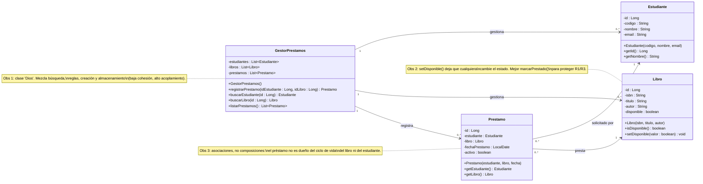
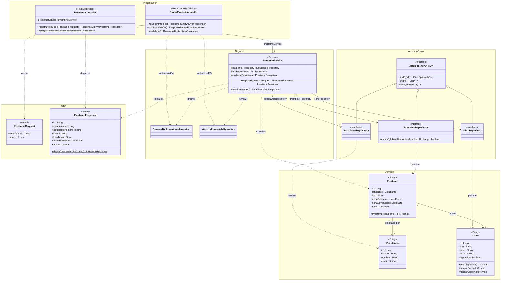
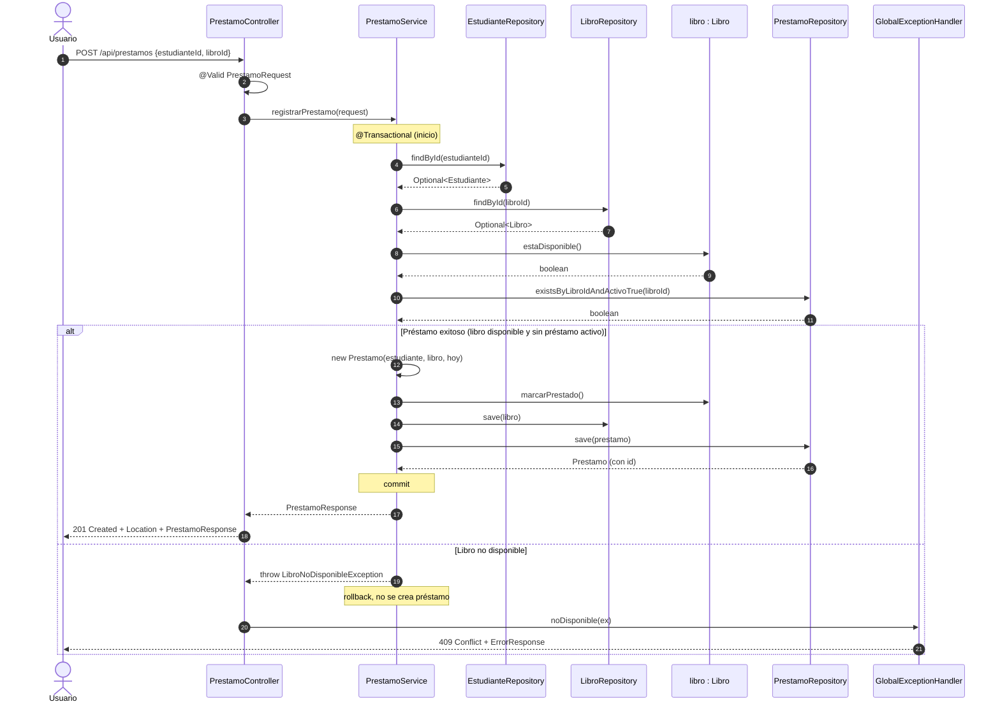

# Taller guiado · SmartLibrary

**Del modelo de clases orientado a objetos a un diseño por tres capas para una API REST**

Diseño de Software · Cuarto semestre · Modalidad: parejas

| Integrantes |
|---|
| Juan Felipe Narváez Herrera |
| Ian Santiago Ordóñez Rosero |

Caso de uso implementado: **Registrar préstamo** (`POST /api/prestamos`) y **Consultar préstamos** (`GET /api/prestamos`).

Reglas del negocio:

| Regla | Enunciado |
|---|---|
| R1 | Solo un libro disponible puede prestarse. |
| R2 | El préstamo registra estudiante, libro y fecha. |
| R3 | Al prestarlo, el libro deja de estar disponible. |
| R4 | Una solicitud inválida no debe crear préstamo. |
| R5 | Un libro puede tener varios préstamos históricos, pero solo uno activo a la vez. |

---

## Actividad 1 · Leer y cuestionar el modelo

### Diagrama inicial anotado

Hecho en Visual Paradigm (`docs/diagramas/SmartLibrary.vpp`, diagrama «1. Modelo inicial anotado»):


<details><summary>Versión en texto (Mermaid)</summary>



</details>

**Observaciones sobre el modelo inicial**

1. `GestorPrestamos` concentra todo: guarda colecciones en memoria, busca, valida, crea y "persiste". Tiene baja cohesión y es imposible probar o reemplazar la persistencia sin tocarlo.
2. Nadie recibe la petición HTTP ni traduce errores a códigos de estado.
3. La persistencia está escondida en listas (`List<...>`): no hay transacciones, así que R3 y R4 pueden quedar a medias.
4. `Libro.setDisponible(boolean)` expone el estado; la regla R1/R3 debería vivir en un método con intención (`marcarPrestado()`).

### Respuestas

**¿Qué datos y operaciones son propios del dominio?**

| Clase | Datos del dominio | Operaciones del dominio |
|---|---|---|
| Estudiante | id, código, nombre, email | consultar sus datos |
| Libro | id, ISBN, título, autor, disponible | `estaDisponible()`, `marcarPrestado()`, `marcarDisponible()` |
| Prestamo | id, estudiante, libro, fechaPrestamo, fechaDevolucion, activo | crear préstamo con estudiante, libro y fecha (R2) |

Las colecciones y búsquedas de `GestorPrestamos` **no** son del dominio: son de acceso a datos. La coordinación de `registrarPrestamo` es lógica de aplicación.

**¿Por qué Libro–Prestamo y Estudiante–Prestamo son asociaciones y no composiciones?**

La composición exige que la parte nazca y muera con el todo. Aquí no ocurre:

- Un libro existe antes del préstamo y sigue existiendo después; además puede tener muchos préstamos históricos (R5). Si borráramos un préstamo, el libro no debe desaparecer.
- Un estudiante existe aunque nunca pida un libro y puede tener cero o muchos préstamos.
- El préstamo solo **referencia** a un estudiante y a un libro (multiplicidad `0..* → 1`). Es una asociación estructural porque guarda esas referencias como atributos.

**¿Qué operaciones son necesarias para consultar, validar y guardar?**

- Consultar: buscar estudiante por id, buscar libro por id, listar préstamos.
- Validar: que el estudiante exista, que el libro exista, que el libro esté disponible y no tenga préstamo activo, que la solicitud traiga los dos ids.
- Guardar: guardar el libro con su nueva disponibilidad y guardar el préstamo, **en una sola transacción**.

**¿Qué responsabilidades faltan?**

- Para recibir HTTP: exponer el endpoint `POST /api/prestamos`, convertir el JSON en un objeto (`PrestamoRequest`), validar el formato, devolver `201`, `404`, `409` o `400` con un cuerpo de respuesta.
- Para acceder a datos: buscar por id, guardar entidades, consultar si un libro ya tiene un préstamo activo. Eso lo dan los repositorios (`EstudianteRepository`, `LibroRepository`, `PrestamoRepository`).

---

## Actividad 2 · Asignar responsabilidades

| Operación o decisión | Clase responsable | Justificación |
|---|---|---|
| Recibir `POST /api/prestamos` | `PrestamoController` | Es la capa de presentación: conoce HTTP, convierte el JSON en `PrestamoRequest` y valida su formato (`@Valid`). No decide reglas de negocio. |
| Buscar estudiante por identificador | `EstudianteRepository` (lo invoca `PrestamoService`) | El acceso a datos se aísla en el repositorio. El servicio decide qué hacer si no existe (404). |
| Buscar libro por identificador | `LibroRepository` (lo invoca `PrestamoService`) | Mismo motivo: el repositorio solo sabe consultar la base de datos. |
| Validar disponibilidad | `PrestamoService` usando `Libro.estaDisponible()` y `PrestamoRepository.existsByLibroIdAndActivoTrue()` | R1 y R5 son reglas del caso de uso. El servicio las coordina; el libro es el experto en su propio estado (GRASP Experto). |
| Crear el préstamo | `PrestamoService` (`new Prestamo(estudiante, libro, fecha)`) | GRASP Creador: el servicio tiene los datos necesarios para inicializar el préstamo (R2). |
| Cambiar disponibilidad | `Libro.marcarPrestado()` invocado por `PrestamoService` | El libro protege su estado; el servicio decide el momento (R3). |
| Guardar cambios | `LibroRepository.save()` y `PrestamoRepository.save()` dentro de un método `@Transactional` del servicio | Persistencia en el repositorio; atomicidad garantizada por la transacción del servicio (R3 y R4). |
| Devolver respuesta HTTP | `PrestamoController` + `GlobalExceptionHandler` | El controlador responde `201 Created` con `PrestamoResponse`; el manejador traduce las excepciones a `404`, `409` y `400`. |

Las entidades `Estudiante`, `Libro` y `Prestamo` se mantienen como modelo del dominio y no son una cuarta capa: las usan las tres capas.

---

## Actividad 3 · Modelo de clases por capas

Hecho en Visual Paradigm (diagrama «2. Modelo de clases por capas»), generado con Instant Reverse desde el código y completado con multiplicidades y dependencias:


<details><summary>Versión en texto (Mermaid)</summary>



</details>

### Justificación de las relaciones

| Relación | Tipo UML | Multiplicidad | Por qué |
|---|---|---|---|
| `Prestamo → Estudiante` | Asociación dirigida | `0..*` a `1` | El préstamo guarda la referencia al estudiante (`@ManyToOne`). Un estudiante puede tener cero o muchos préstamos. Se conserva del modelo inicial. |
| `Prestamo → Libro` | Asociación dirigida | `0..*` a `1` | Igual: referencia persistente. Varios préstamos históricos por libro (R5). Sin composición porque el libro sobrevive al préstamo. |
| `PrestamoController → PrestamoService` | Asociación dirigida | `1` a `1` | El controlador mantiene el servicio como atributo (inyección por constructor). Es una referencia que dura toda la vida del objeto, no un uso puntual. |
| `PrestamoService → *Repository` | Asociación dirigida | `1` a `1` | Mismo motivo: tres atributos `final` inyectados. |
| `PrestamoController ..> PrestamoRequest / PrestamoResponse` | Dependencia | — | Solo aparecen como parámetro y retorno de un método; no se guardan. |
| `PrestamoService ..> Prestamo` | Dependencia «create» | — | El servicio crea el préstamo dentro del método pero no lo conserva como atributo. |
| `*Repository ..> Entidad` | Dependencia | — | El repositorio maneja la entidad por parámetro genérico, no la guarda como atributo. |
| `JpaRepository <\|-- *Repository` | Generalización entre interfaces | — | Los repositorios son **interfaces** que extienden `JpaRepository`. No hay realización escrita por nosotros: Spring Data genera la implementación en ejecución. |
| `GestorPrestamos` | **Eliminada** | — | Sus responsabilidades se repartieron entre Controller, Service y Repository. |

Dirección de dependencias: **Controller → Service → Repository**. El controlador nunca toca un repositorio y las entidades no dependen de ninguna capa.

---

## Actividad 4 · Diagrama de secuencia de `POST /api/prestamos`

Hecho en Visual Paradigm (diagrama «3. Secuencia POST /api/prestamos»). El fragmento `alt` muestra los dos caminos: préstamo exitoso (201) y libro no disponible (409).


<details><summary>Versión en texto (Mermaid)</summary>



</details>

Caminos de error adicionales (mismo patrón): si `findById` devuelve vacío, el servicio lanza `RecursoNoEncontradoException` y el manejador responde **404 Not Found**; si falta un id, la validación `@Valid` falla antes de llegar al servicio y se responde **400 Bad Request** (R4).

**Verificación mensaje ↔ operación del diagrama de clases**

| Mensaje | Operación en el diagrama de clases |
|---|---|
| `registrarPrestamo(request)` | `PrestamoService.registrarPrestamo(PrestamoRequest)` |
| `findById(...)` | `JpaRepository.findById(ID)` heredada por `EstudianteRepository` y `LibroRepository` |
| `estaDisponible()` | `Libro.estaDisponible()` |
| `existsByLibroIdAndActivoTrue(libroId)` | `PrestamoRepository.existsByLibroIdAndActivoTrue(Long)` |
| `new Prestamo(...)` | Constructor `Prestamo(estudiante, libro, fecha)` |
| `marcarPrestado()` | `Libro.marcarPrestado()` |
| `save(...)` | `JpaRepository.save(T)` |
| `noDisponible(ex)` | `GlobalExceptionHandler.noDisponible(LibroNoDisponibleException)` |

---

## Actividad 5 · Preparación de la implementación

Proyecto creado con Spring Boot 3.3.5, **Java 21**, **Maven**, y las dependencias **Spring Web**, **Spring Data JPA**, **Validation** y **H2**.

```
src/main/java/com/smartlibrary
├── SmartLibraryApplication.java
├── controller/   PrestamoController
├── service/      PrestamoService
├── repository/   EstudianteRepository, LibroRepository, PrestamoRepository
├── model/        Estudiante, Libro, Prestamo
├── dto/          PrestamoRequest, PrestamoResponse, ErrorResponse
└── exception/    RecursoNoEncontradoException, LibroNoDisponibleException, GlobalExceptionHandler
src/main/resources
├── application.properties   (H2 en memoria, consola en /h2-console)
└── data.sql                 (estudiantes y libros de prueba)
```

---

## Actividad 6 · Implementación y pruebas

### Decisiones que se reflejan en el UML

- Se agregó el paquete `exception` con `GlobalExceptionHandler` para traducir excepciones a `404` y `409` (el taller exige manejo explícito).
- Se agregó `PrestamoResponse` para no exponer las entidades JPA en la respuesta.
- `registrarPrestamo` es `@Transactional`: el cambio de disponibilidad y la creación del préstamo se confirman juntos o se revierten juntos.
- `Libro.setDisponible()` se reemplazó por `marcarPrestado()` / `marcarDisponible()`.
- `PrestamoRepository.existsByLibroIdAndActivoTrue()` refuerza R5 aunque el campo `disponible` quedara desincronizado.

### Datos iniciales (`data.sql`)

| Id | Estudiante | | Id | Libro | Disponible |
|---|---|---|---|---|---|
| 1 | Ana Gómez | | 1 | Effective Java | Sí |
| 2 | Carlos Ruiz | | 2 | Clean Code | Sí |
| | | | 3 | Design Patterns | No (préstamo activo de Carlos) |

### Resultados de los escenarios

Pruebas automáticas en `src/test/java` (`PrestamoControllerIntegrationTest` y `PrestamoServiceTest`). Resultado de `mvnw test`: **11 pruebas, 0 fallos**.

| Escenario | Solicitud | Resultado esperado | Resultado obtenido |
|---|---|---|---|
| Préstamo de libro disponible | `POST {"estudianteId":1,"libroId":1}` | 201 Created y préstamo registrado | ✅ 201, libro 1 queda no disponible |
| Libro ya prestado | `POST {"estudianteId":1,"libroId":3}` | 409 Conflict; sin nuevo préstamo | ✅ 409, número de préstamos sin cambio |
| Estudiante inexistente | `POST {"estudianteId":99,"libroId":1}` | 404 Not Found | ✅ 404 |
| Libro inexistente | `POST {"estudianteId":1,"libroId":99}` | 404 Not Found | ✅ 404 |
| Consulta de préstamos | `GET /api/prestamos` | 200 OK con registros | ✅ 200 con la lista |
| Solicitud inválida (extra, R4) | `POST {"estudianteId":1}` | 400 Bad Request; sin préstamo | ✅ 400 |
| Mismo libro dos veces (extra, R5) | dos `POST` al libro 2 | el segundo da 409 | ✅ 409 |

> Concurrencia: dos solicitudes simultáneas por el mismo libro podrían pasar ambas la validación antes de guardar. Se podría resolver con bloqueo optimista (`@Version` en `Libro`) o una restricción única sobre el préstamo activo; queda fuera del alcance del taller.

---

## Actividad 7 · Revisión y defensa

**¿Qué responsabilidades cambiaron del modelo inicial al modelo por capas?**
`GestorPrestamos` desapareció. Recibir HTTP y responder pasó a `PrestamoController` (y `GlobalExceptionHandler`); coordinar el caso de uso, validar reglas y crear el préstamo pasó a `PrestamoService`; buscar y guardar pasó a los tres repositorios. Las listas en memoria se cambiaron por persistencia en H2. El libro ganó métodos con intención (`marcarPrestado()`) en lugar de un `setter` público.

**¿Qué patrón GRASP se reconoce en la coordinación del caso de uso? ¿Por qué un controlador GRASP no equivale necesariamente a `@RestController`?**
Se reconoce **Controlador** (de caso de uso): `PrestamoService` es el primer objeto fuera de la interfaz que recibe la operación del sistema `registrarPrestamo` y coordina a los demás. También aparecen **Experto en información** (`Libro` sabe si está disponible), **Creador** (el servicio crea `Prestamo` porque tiene los datos para inicializarlo), **Bajo acoplamiento** y **Alta cohesión**, e **Indirección/Fabricación pura** en los repositorios.
El `@RestController` es un adaptador de la tecnología web: traduce HTTP a llamadas Java. El controlador GRASP es un concepto de diseño independiente de la interfaz; si mañana el préstamo se registra desde una consola o una cola de mensajes, `PrestamoService` sigue siendo el controlador del caso de uso y solo cambia el adaptador de entrada.

**¿Dónde se ubica la regla de disponibilidad y por qué?**
En la capa de negocio: `PrestamoService.registrarPrestamo()` la verifica, apoyándose en `Libro.estaDisponible()` (el estado vive en la entidad) y en `PrestamoRepository.existsByLibroIdAndActivoTrue()` (R5). No va en el controlador porque es una regla del negocio y no de HTTP, ni en el repositorio porque este solo accede a datos. Así la regla se cumple sin importar quién invoque el servicio y se prueba sin servidor web (ver `PrestamoServiceTest`).

**¿Qué relaciones UML conservaron y cuáles modificaron?**
Se conservaron las asociaciones `Prestamo 0..* → 1 Estudiante` y `Prestamo 0..* → 1 Libro`, sin agregación ni composición. Se eliminaron las asociaciones `GestorPrestamos 1 → 0..*` con las tres colecciones. Se añadieron asociaciones `1 → 1` entre capas (Controller → Service → Repositorios, por inyección), dependencias hacia los DTO y hacia `Prestamo` («create»), y generalización de los repositorios desde `JpaRepository`.

**¿Cómo se comprueba la trazabilidad requisito → clase → operación → prueba?**

| Requisito | Clase | Operación | Prueba |
|---|---|---|---|
| R1 libro disponible | `PrestamoService`, `Libro` | `registrarPrestamo()`, `estaDisponible()` | `libroYaPrestado`, `rechazaLibroNoDisponibleSinGuardarNada` |
| R2 registra estudiante, libro y fecha | `Prestamo` | `Prestamo(estudiante, libro, fecha)` | `prestamoDeLibroDisponible` |
| R3 libro deja de estar disponible | `Libro`, `PrestamoService` | `marcarPrestado()` | `prestamoDeLibroDisponible`, `registraPrestamoYMarcaLibroComoPrestado` |
| R4 solicitud inválida no crea préstamo | `PrestamoRequest`, `GlobalExceptionHandler`, `PrestamoService` | `@Valid`, `invalido()`, `@Transactional` | `solicitudInvalida`, `estudianteInexistente`, `libroInexistente` |
| R5 un solo préstamo activo | `PrestamoRepository` | `existsByLibroIdAndActivoTrue()` | `segundoPrestamoDelMismoLibro` |
| Consulta | `PrestamoController`, `PrestamoService` | `listar()`, `listarPrestamos()` | `consultaDePrestamos` |

---

## Entregables

- [x] Diagrama inicial anotado con observaciones (Actividad 1).
- [x] Tabla de responsabilidades completa (Actividad 2).
- [x] Diagrama de clases por capas con relaciones y multiplicidades justificadas (Actividad 3).
- [x] Diagrama de secuencia con camino exitoso y libro no disponible (Actividad 4).
- [x] Código Spring Boot por capas y pruebas de los escenarios (Actividades 5 y 6).
- [x] Respuestas de revisión y defensa con trazabilidad (Actividad 7).
